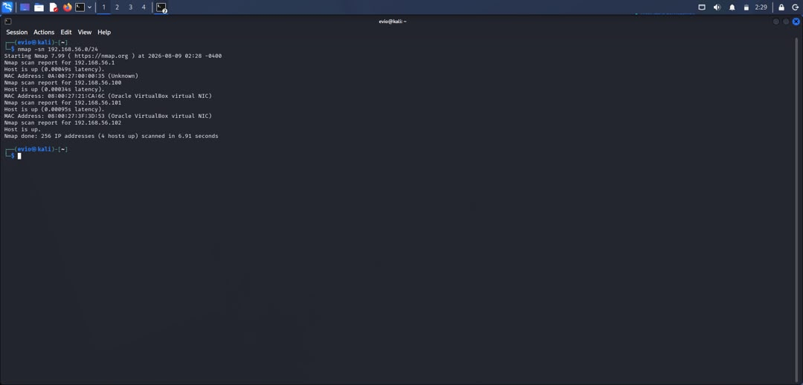
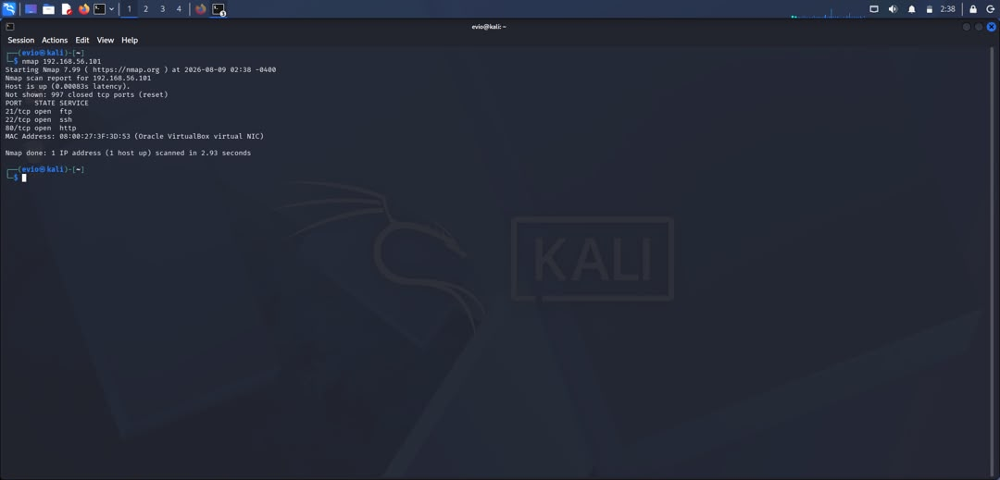
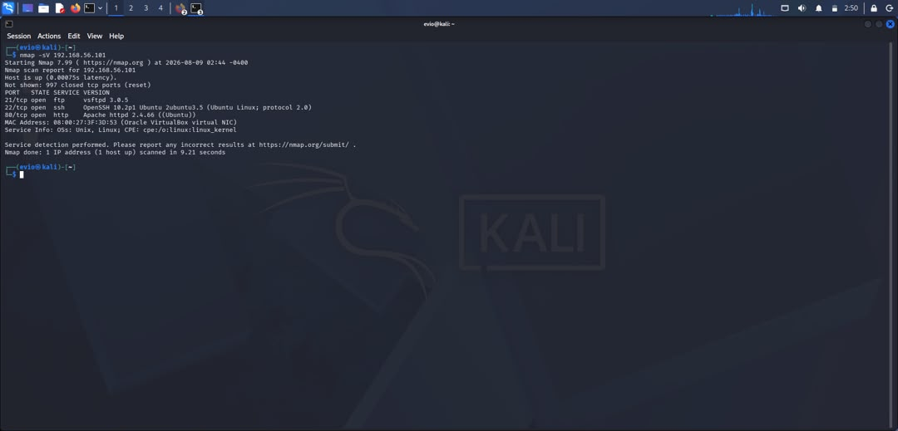
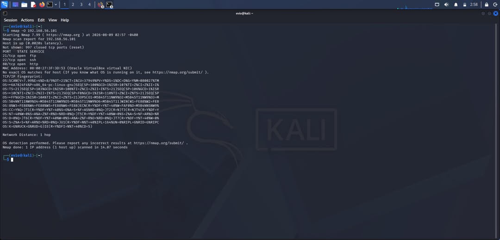
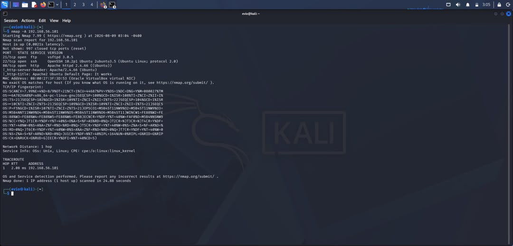
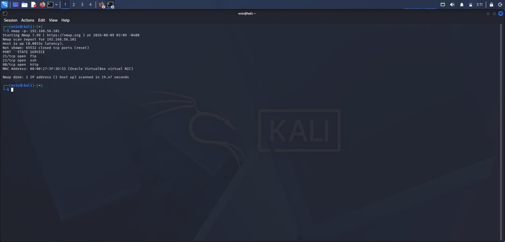

# Network Discovery & Security Assessment — Nmap

## Objective
Simulate a network reconnaissance and security assessment to identify live 
hosts, open ports, and running services on a target machine, and evaluate 
potential security risks.

## Environment
- Attacker machine: Kali Linux (VirtualBox)
- Target machine: Ubuntu Server (VirtualBox)
- Network: Host-only adapter, 192.168.56.0/24
- Target IP: 192.168.56.101

## Methodology
1. Performed host discovery across the subnet
2. Ran a basic port scan on the target
3. Ran service/version detection
4. Ran OS detection
5. Ran a full aggressive scan
6. Scanned all 65535 ports for completeness

## Results

### Host Discovery

`nmap -sn 192.168.56.0/24`
4 live hosts detected on the subnet: gateway (192.168.56.1), Kali attacker 
machine (192.168.56.100), Ubuntu target (192.168.56.101), and an 
unidentified host (192.168.56.102, likely VirtualBox's virtual DHCP server).

### Basic Port Scan

`nmap 192.168.56.101`
3 open ports found: 21 (ftp), 22 (ssh), 80 (http).

### Service/Version Detection

`nmap -sV 192.168.56.101`
- Port 21: vsftpd 3.0.5
- Port 22: OpenSSH 10.2p1 Ubuntu 2ubuntu3.5 (protocol 2.0)
- Port 80: Apache httpd 2.4.66 (Ubuntu)

### OS Detection

`nmap -O 192.168.56.101`
No exact OS match was returned — Nmap fell back to a raw TCP/IP fingerprint. 
This is a common limitation when scanning VMs, since virtual network 
adapters produce a less distinctive fingerprint than physical hardware.

### Aggressive Scan

`nmap -A 192.168.56.101`
Combined scan confirming the same three services and versions, with 
additional details: service info identified the host as Unix/Linux 
(CPE: cpe:/o:linux:linux_kernel), and traceroute showed the target is 
1 hop away, consistent with the isolated host-only lab network.

### Full Port Scan

`nmap -p- 192.168.56.101`
Scanned all 65,535 ports — confirmed no additional hidden or non-standard 
ports beyond the original three (21, 22, 80).

## Findings

| Port | Service | Version | Risk |
|------|---------|---------|------|
| 21   | FTP     | vsftpd 3.0.5 | FTP transmits credentials and data in plaintext; vulnerable to interception. Anonymous login should be checked and disabled if enabled. |
| 22   | SSH     | OpenSSH 10.2p1 (Ubuntu) | Generally secure if configured correctly, but should enforce key-based authentication and disable root/password login to reduce brute-force risk. |
| 80   | HTTP    | Apache httpd 2.4.66 | Unencrypted web traffic; default Apache page suggests the service may not be fully configured, which can leak version info to attackers. |

## Recommendations
- Disable FTP or replace with SFTP/FTPS for encrypted file transfer
- Enforce SSH key-based authentication and disable password-based login
- Implement HTTPS with a TLS certificate for the web service
- Replace or customize the default Apache page to avoid leaking server details
- Regularly patch and update all exposed services
- Restrict unnecessary open ports using a host-based firewall (e.g. ufw)

## Skills Demonstrated
Network reconnaissance, Nmap scanning, service enumeration, OS fingerprinting, 
vulnerability identification, risk assessment, technical report writing

