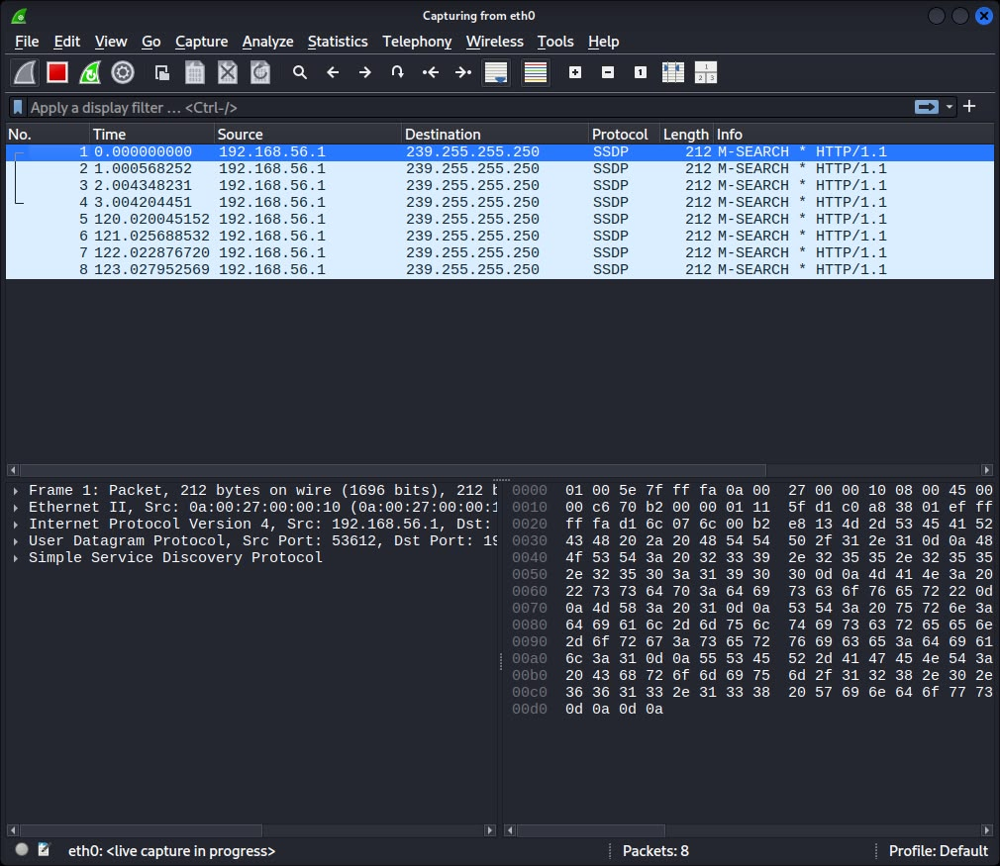
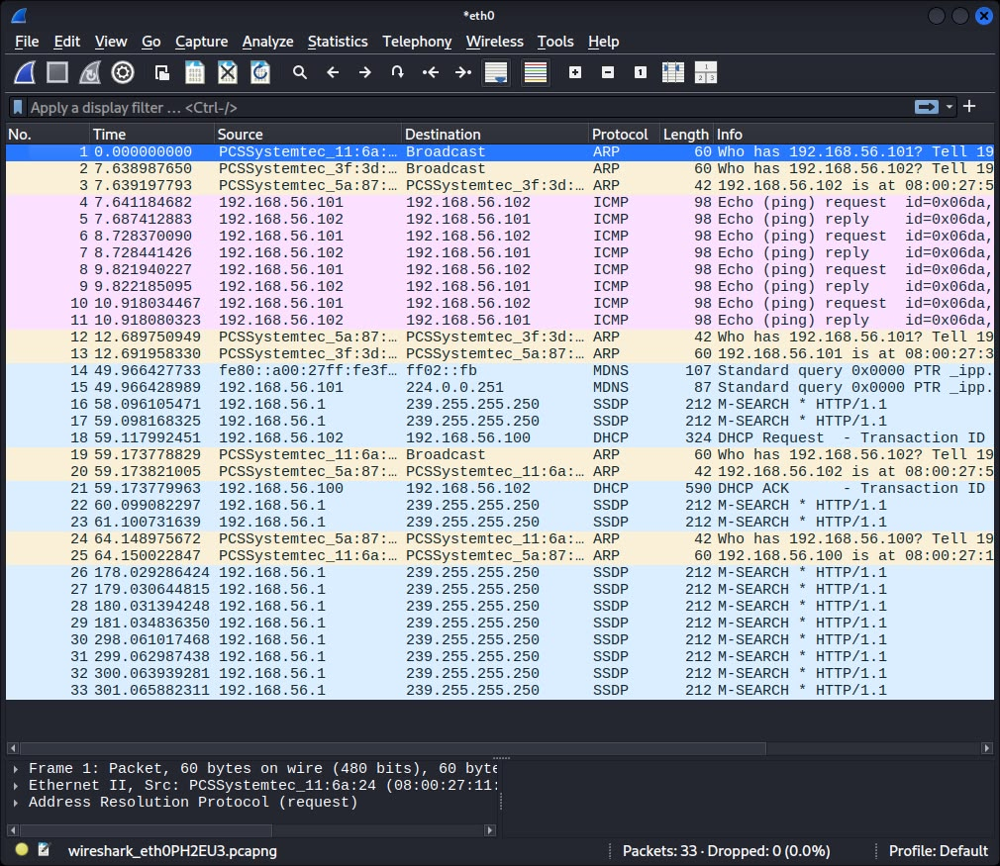
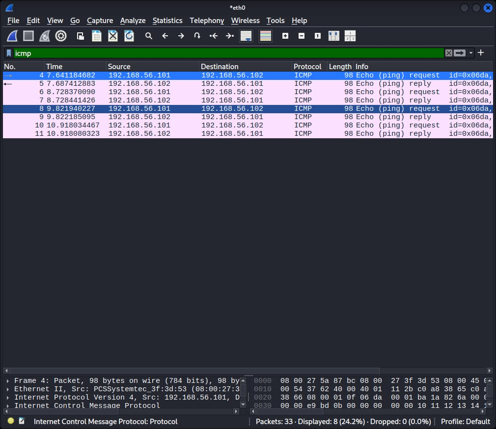
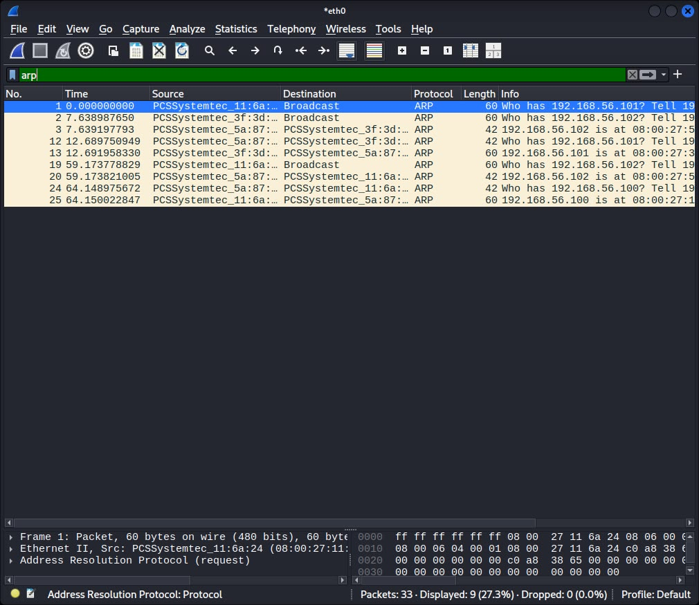
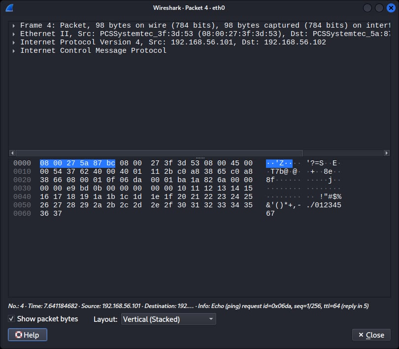

# Network Traffic Analysis — Wireshark

## Objective
Capture and analyze live network traffic on an isolated lab network to 
understand how devices communicate at the packet level, and identify what 
information is visible to someone monitoring the network.

## Environment
- Capture machine: Kali Linux (VirtualBox)
- Traffic source: Ubuntu Server (VirtualBox)
- Network: Host-only adapter, 192.168.56.0/24
- Ubuntu IP: 192.168.56.101
- Kali IP: 192.168.56.102

## Methodology
1. Started a live packet capture on Kali using Wireshark, on the host-only interface
2. Generated ICMP (ping) traffic from Ubuntu targeting Kali
3. Stopped the capture and reviewed the full packet list
4. Filtered traffic by protocol (ICMP, ARP) to isolate and analyze each type
5. Inspected an individual ICMP packet in detail

## Results

### Starting the Capture

Selected the host-only network interface and began capturing live traffic.

### Full Capture Overview

Captured a mix of ARP, ICMP, MDNS, SSDP, and DHCP traffic — a combination of 
traffic generated deliberately (ping) and background traffic naturally 
occurring on the network (device discovery and broadcast protocols).

### ICMP Traffic

Filtered using icmp — shows the ping request/reply exchange between Ubuntu 
(192.168.56.101) and Kali (192.168.56.102), confirming connectivity at the 
packet level.

### ARP Traffic

Filtered using arp — shows devices on the network asking "who has this IP?" 
and the corresponding replies with MAC addresses. This is how devices on a 
local network locate each other before sending direct traffic.

### ICMP Packet Detail

Expanded view of a single ICMP packet, showing the full request/reply 
structure at the protocol level.

## Findings

| Protocol | Observation | Risk |
|----------|-------------|------|
| ICMP | Ping requests/replies fully visible, including source/destination | Can be used by an attacker for network mapping and host discovery |
| ARP | Devices broadcast requests asking "who has this IP" in plaintext | ARP has no authentication — vulnerable to ARP spoofing/poisoning attacks, where an attacker impersonates another device on the network |
| MDNS/SSDP | Devices contin