# Linux Server Hardening Lab

## Objective
Harden a Linux server (Ubuntu Server, VirtualBox) by reducing its attack
surface: patching, restricting SSH access, enabling a firewall, disabling
unnecessary services, and adding brute-force protection. Builds on the
baseline established in the Nmap Network Discovery project.

## Environment
- Hypervisor: VirtualBox
- Target: Ubuntu Server (192.168.56.101)
- Admin machine: Kali Linux
- Network: Host-only adapter (isolated lab network)

## Baseline Snapshot
Saved a before-hardening snapshot prior to any changes, to allow rollback
if a change locked out access.

## 1. System Updates
Ran apt update && apt upgrade to patch known vulnerabilities. Unpatched
software is one of the most common initial access vectors for attackers.

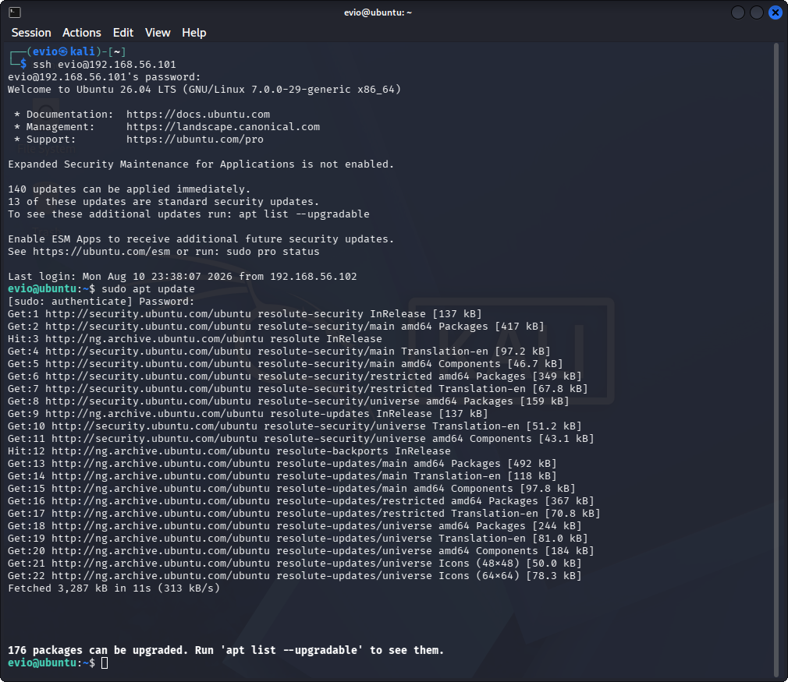
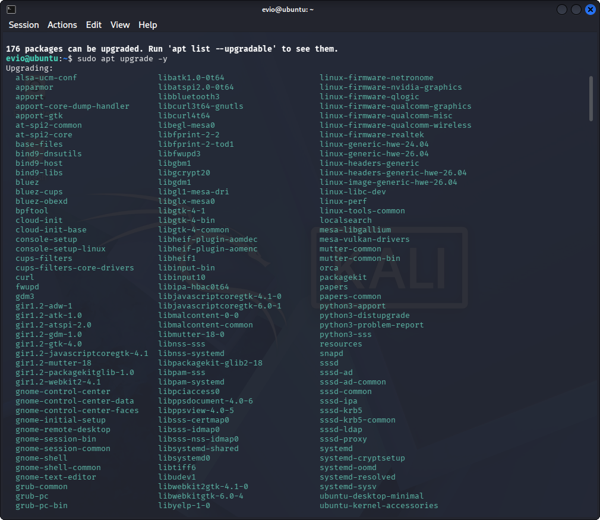

## 2. User Account Hardening
- Reviewed all accounts with shell access.
- Locked the root account (passwd -l root) to prevent direct root login.
- Verified only one account holds UID 0 — confirms no unauthorized
  privilege escalation via duplicate UID 0 accounts.

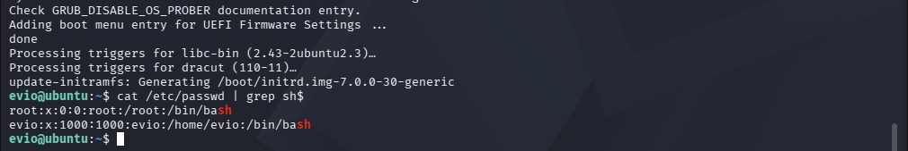
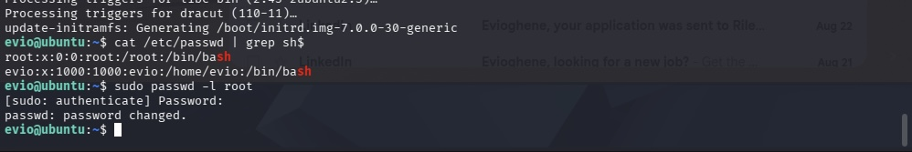
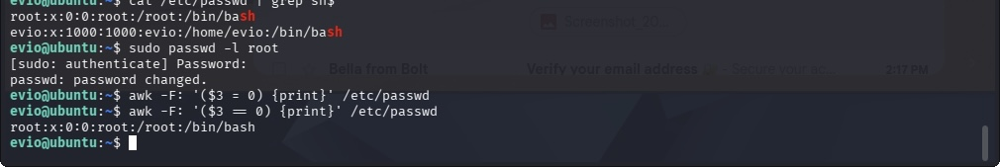

## 3. SSH Hardening
- Generated an SSH keypair on the admin machine and configured key-based
  authentication on the server.
- Disabled password authentication to eliminate brute-force login as a
  viable attack path.
- Disabled root login over SSH (PermitRootLogin no).
- Reduced MaxAuthTries to 3 to slow automated login attempts.
- Disabled X11 forwarding (not needed on a headless server).

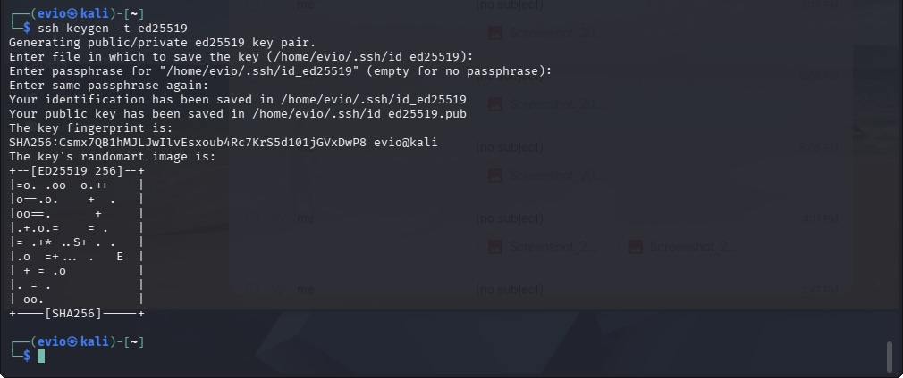
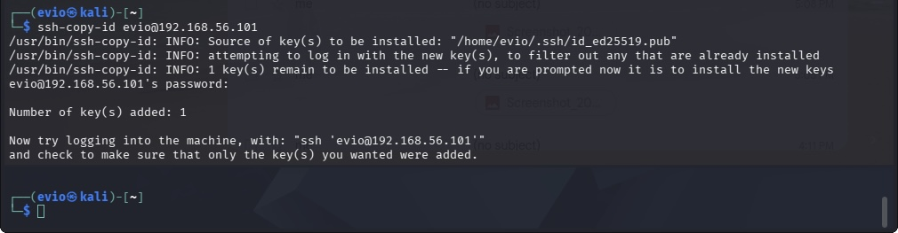
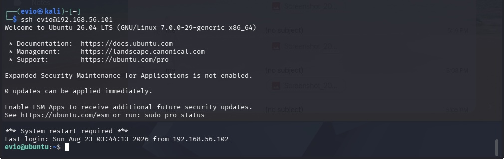

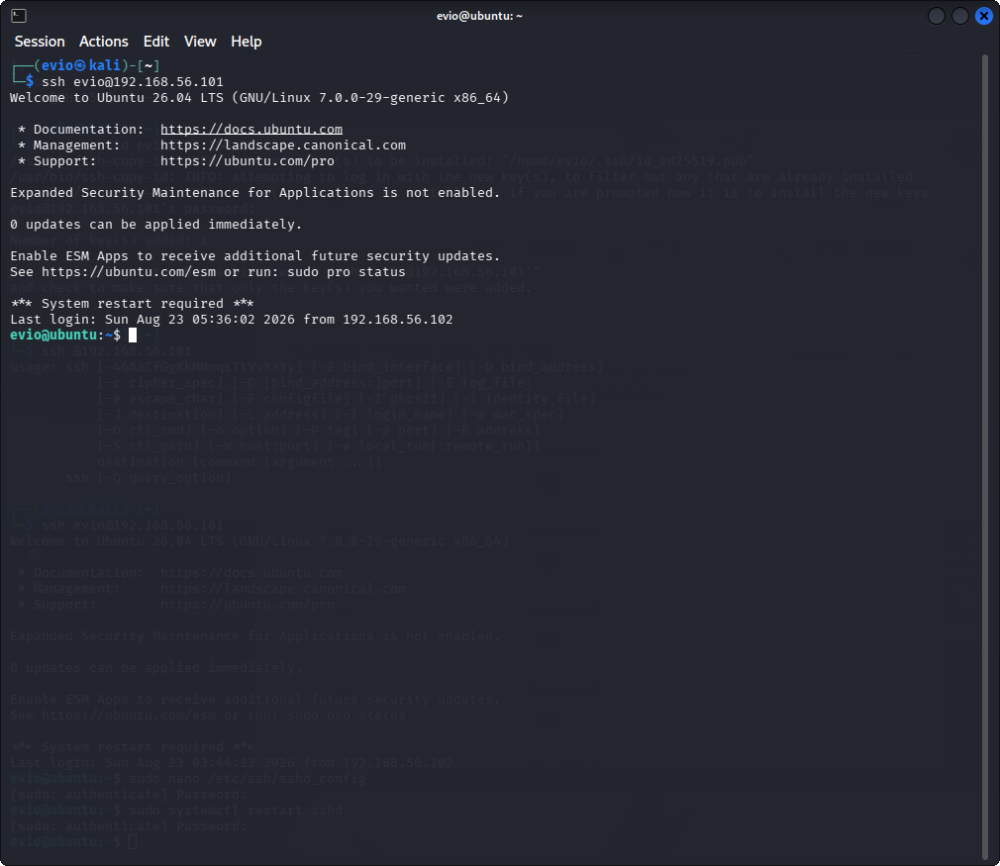
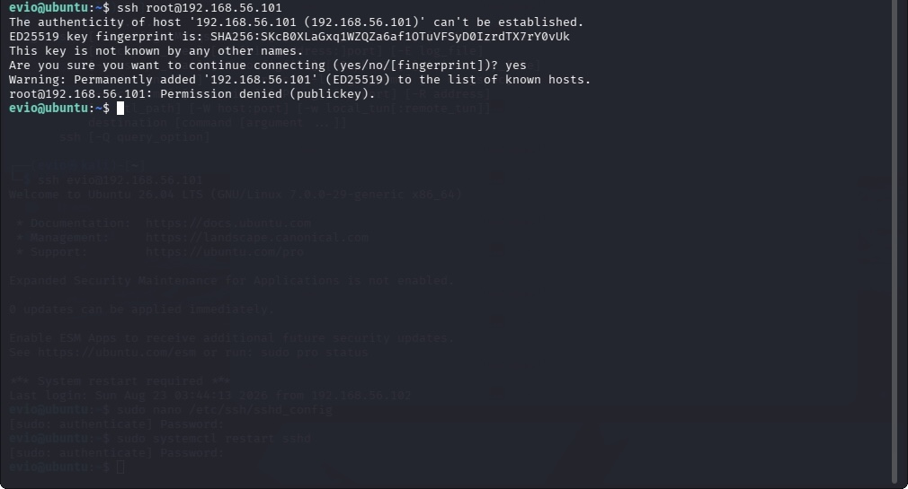

## 4. Firewall Configuration (UFW)
Set default policy to deny all incoming traffic, allow all outgoing.
Explicitly allowed only required ports (22, 80) — least-privilege network
access, only reachable services are reachable.

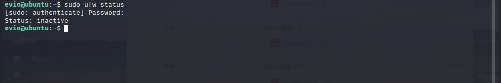
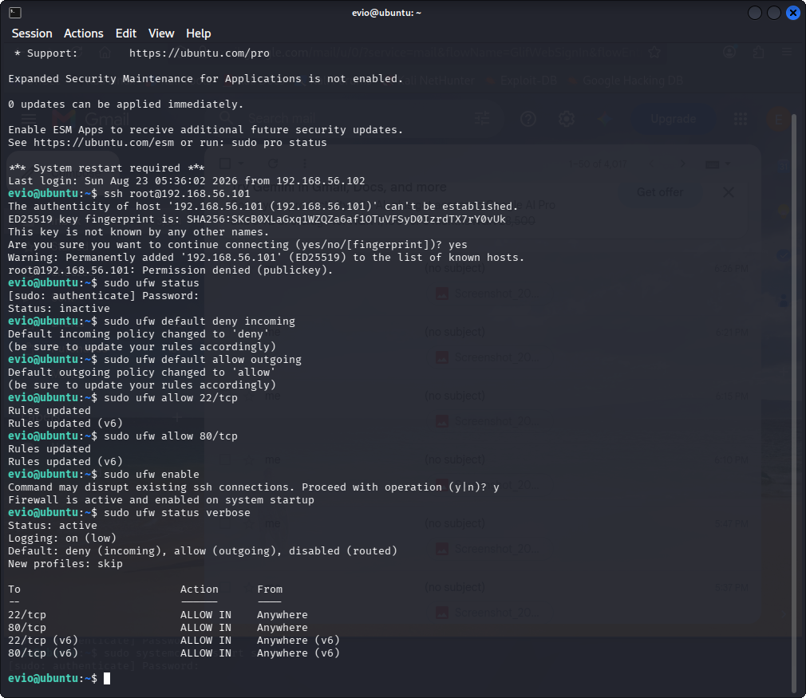

## 5. Service Minimization
Reviewed all enabled services (`systemctl list-unit-files --type=service
--state=enabled`) and disabled anything unnecessary for a headless lab
server:

- avahi-daemon — network auto-discovery (mDNS), unneeded attack surface
- bluetooth — irrelevant on a headless server
- cups — printing support, server doesn't print
- ModemManager — for cellular/mobile modems, not applicable to a VM
- openvpn — not used in this lab
- sssd — domain/LDAP authentication, not relevant here

Kept cups-browsed, apache2, and vsftpd running since the Nmap Network
Discovery project depends on apache2/vsftpd, along with ssh, ufw,
cron, rsyslog, and core networking services.

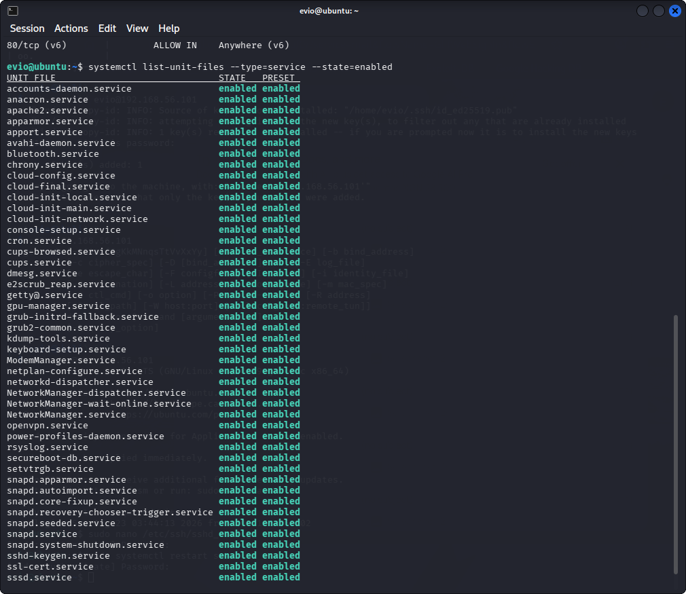

## 6. Brute-Force Protection (fail2ban)
Installed and enabled fail2ban with the default sshd jail — automatically
bans IPs after repeated failed SSH login attempts, mitigating brute-force
attacks even on the allowed port.

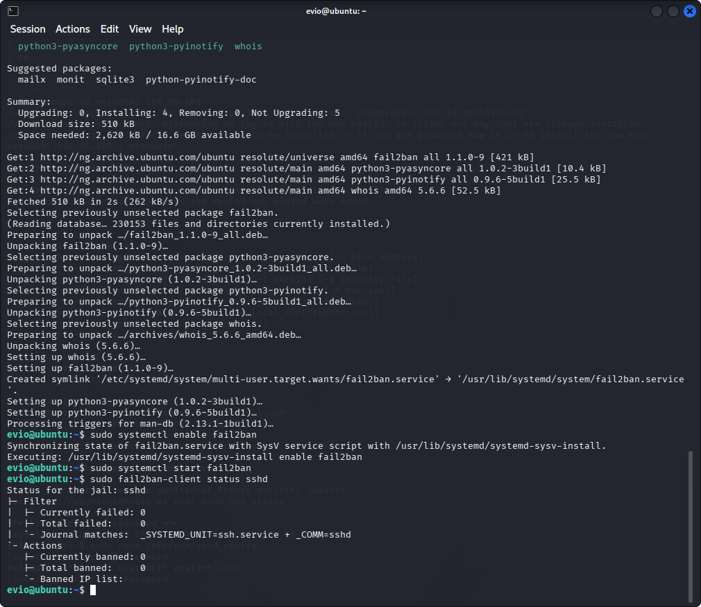

## Verification
Re-ran Nmap post-hardening and compared to the Project 1 baseline.

*Before:* 21/tcp open, 22/tcp open (password auth allowed, root login allowed), 80/tcp open
*After:* 21/tcp open, 22/tcp open (key-only, no root), 80/tcp open, fail2ban active on port 22

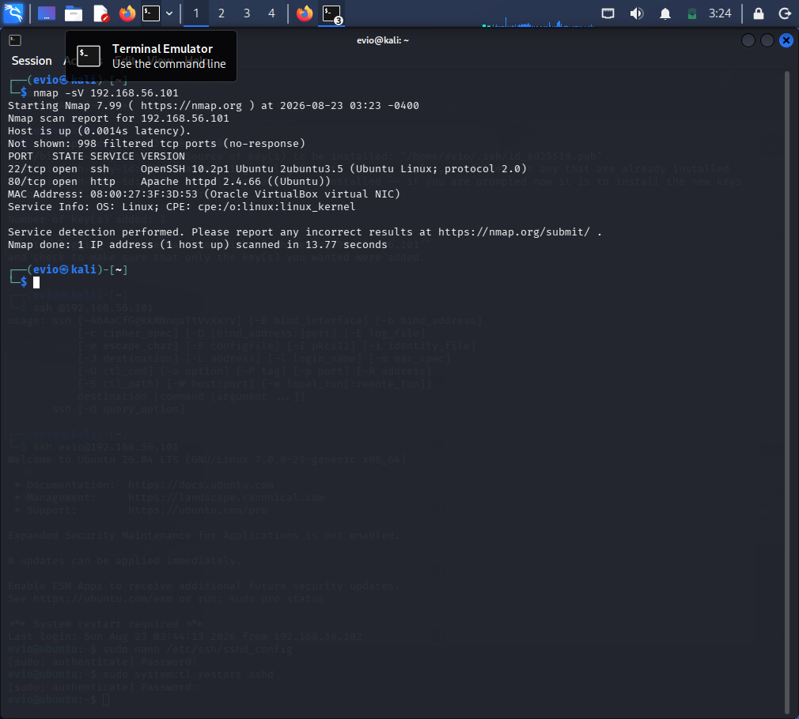

Confirmed:
- Root SSH login refused
- Password-based SSH login refused
- Key-based SSH login succeeds
- UFW blocking all ports except 22/80
- fail2ban actively monitoring SSH

## Key Takeaways
Hardening doesn't always reduce the number of open ports — it reduces
what's exploitable on those ports. Access control (key-only auth, no root
login) and monitoring (fail2ban) matter as much as closing ports outright,
which maps directly to defense-in-depth concepts used in SOC environments.