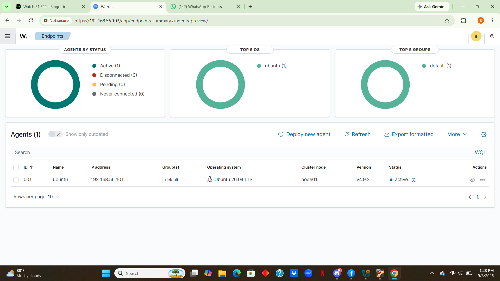
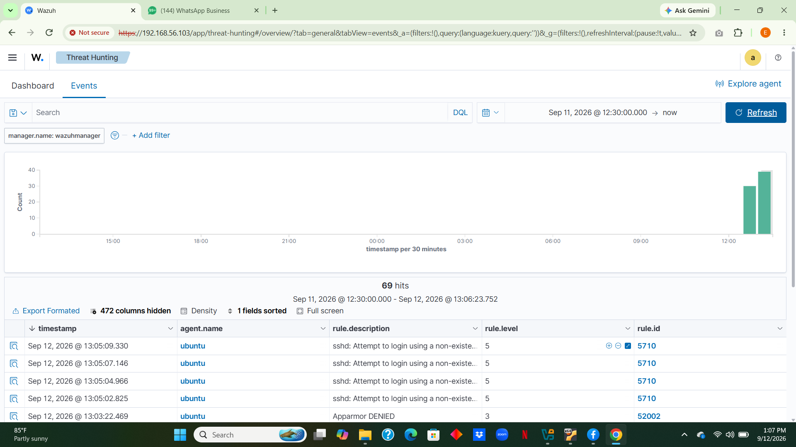
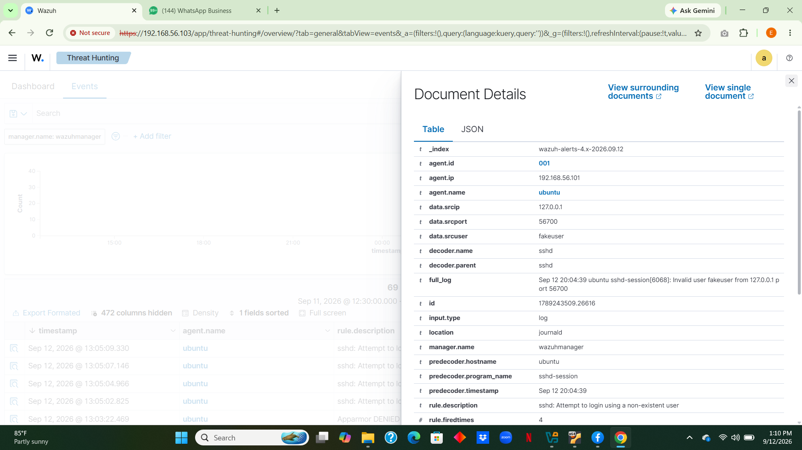
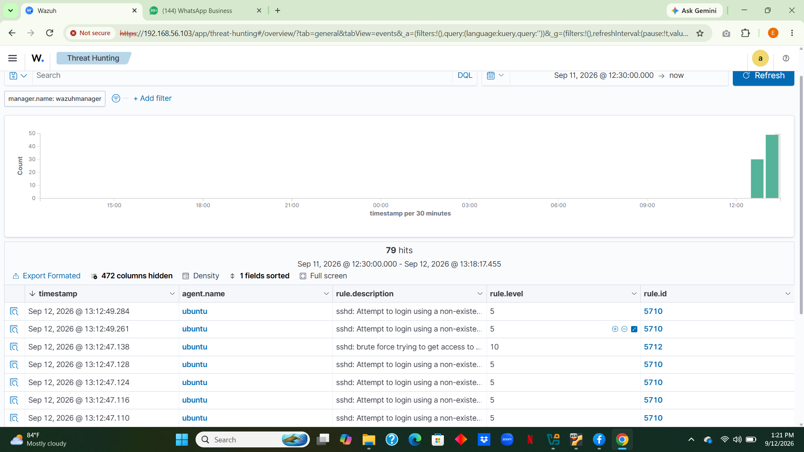
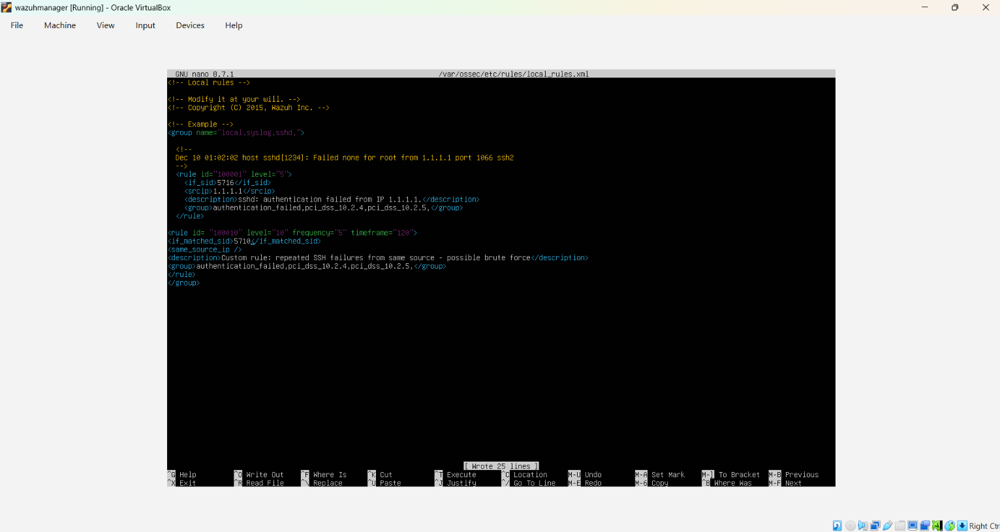
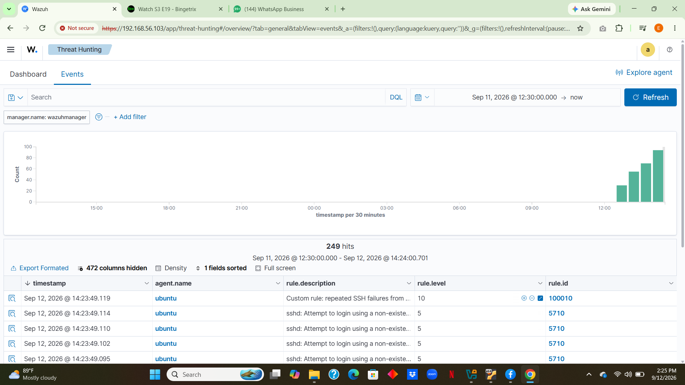

# Wazuh SIEM Lab

## Objective
Deploy a Wazuh SIEM manager and connect an endpoint agent to monitor
authentication events and detect brute-force SSH attempts in a home lab
environment, simulating a basic SOC monitoring setup.

## Environment
- Wazuh Manager: Ubuntu Server 26.04 LTS, VirtualBox VM (Host-only network)
- Agent: Ubuntu Server (existing Nmap/Wireshark lab VM)
- Wazuh version: 4.9.2
- Network: VirtualBox Host-only adapter (192.168.56.0/24)

## What I Built
- Installed Wazuh Indexer, Manager, and Dashboard using the all-in-one
  install script
- Deployed and registered a Wazuh agent on a separate Ubuntu VM
- Verified agent connectivity and active status via the dashboard
- Generated and analyzed SSH authentication failure alerts
- Triggered and identified a brute-force detection alert using Wazuh's
  default correlation rules
- Wrote and debugged a custom detection rule in local_rules.xml to flag
  repeated SSH failures from the same source IP

## Key Findings
Default Wazuh rules detected individual SSH authentication failures at
severity level 5, and correctly escalated to a brute-force detection alert
at severity level 10 (rule 5712) after repeated failed attempts from the
same source within a short window — demonstrating that Wazuh's correlation
engine distinguishes between isolated failures and active attack patterns,
not just raw log volume.

Writing a custom rule surfaced two real configuration errors that had to be
debugged directly from the Wazuh analysis engine logs (ossec.log):
1. same_source_ip requires a paired if_matched_sid and a
   frequency/timeframe definition — using if_sid alone caused the
   manager to fail on startup with "Invalid use of frequency/context options."
2. The if_matched_sid value must reference the exact rule ID actually
   firing (5710), not a broader parent category ID (5716) — referencing the
   parent silently prevented the custom rule from ever triggering, even
   though the manager started successfully.

Both issues were diagnosed by reading /var/ossec/logs/ossec.log directly
rather than relying on the dashboard, reinforcing that log-level
troubleshooting is often faster than UI-based debugging for service-level
failures.

## Screenshots


*Agent showing Active in the dashboard*


*List of SSH authentication failure alerts*


*Expanded detail view of one alert*


*Higher-severity brute-force detection (rule level 10)*


*Custom rule added to local_rules.xml*


*Custom rule (100010) successfully firing*


## Custom Rule
```xml
<rule id="100010" level="10" frequency="5" timeframe="120">
  <if_matched_sid>5710</if_matched_sid>
  <same_source_ip />
  <description>Custom rule: repeated SSH failures from same source - possible brute force</description>
  <group>authentication_failed,pci_dss_10.2.4,pci_dss_10.2.5,</group>
</rule>
This rule triggers when the same source IP generates 5 or more matches
against rule 5710 (non-existent user SSH login attempts) within a 120-second
window, flagging it as a probable brute-force attempt at severity level 10.

Skills Demonstrated

	•	SIEM deployment and configuration (Wazuh Indexer, Manager, Dashboard)
	•	Log analysis and alert triage
	•	Custom detection rule writing and debugging
	•	Linux service management (systemd)
	•	VirtualBox host-only networking
	•	Reading and interpreting application logs to resolve service failures